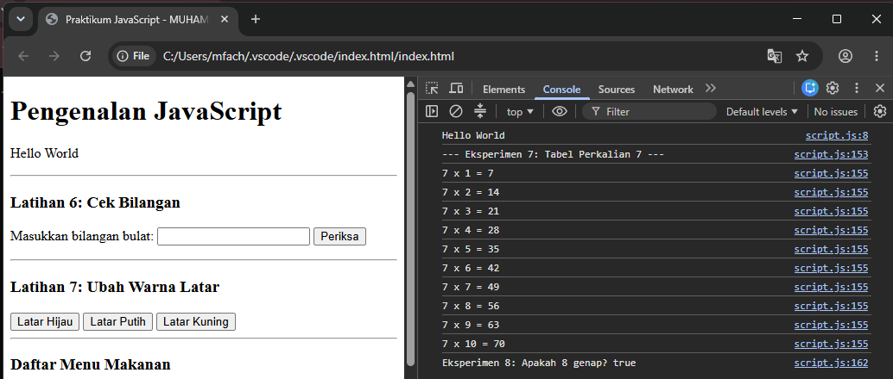
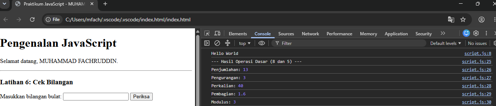
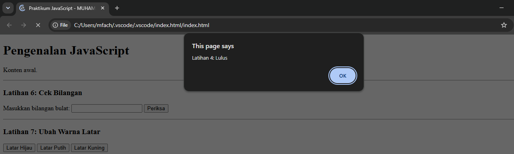
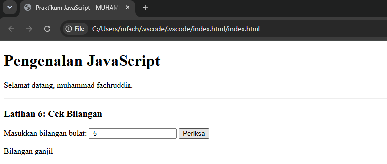
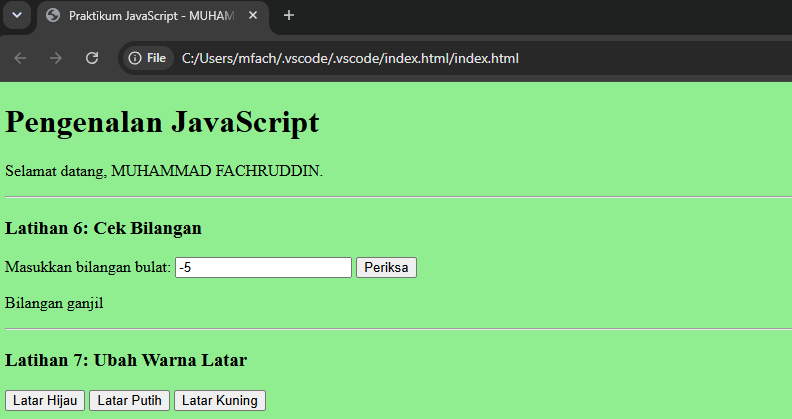
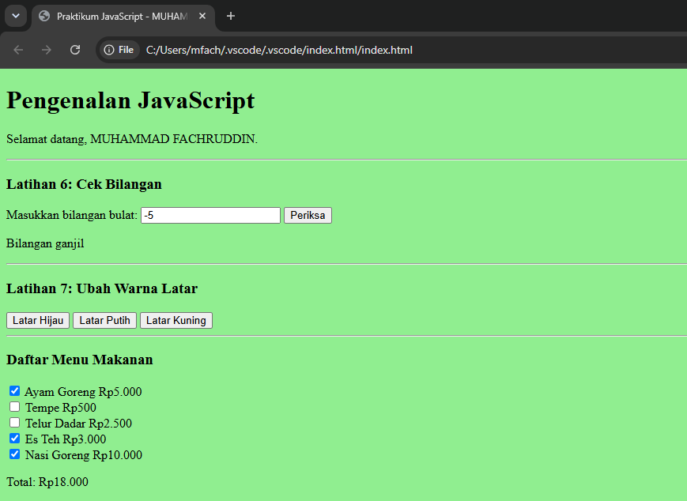
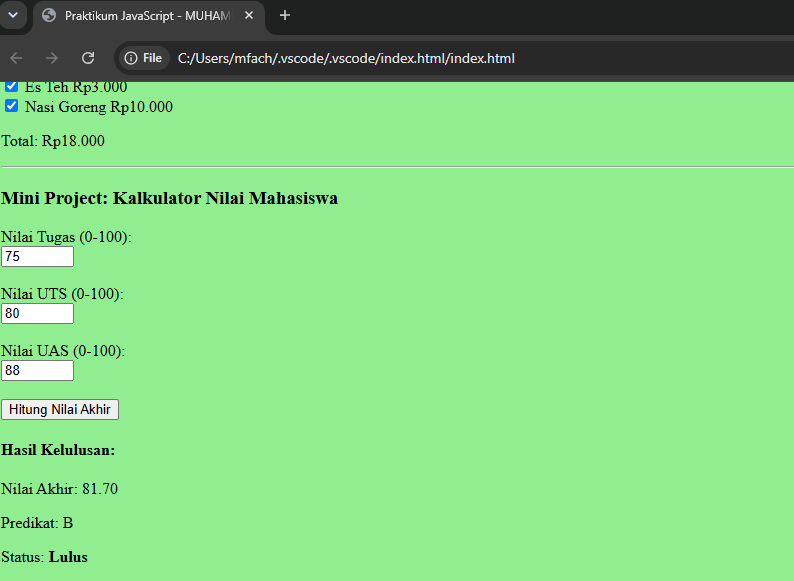

# Laporan Praktikum Pertemuan 6 - JavaScript Dasar

**Nama:** MUHAMMAD FACHRUDDIN  
**NIM:** 312510103  
**Mata Kuliah:** Pemrograman Web  

---

## A. Tujuan Praktikum
Memahami sintaks dasar JavaScript, penggunaan variabel, percabangan, perulangan, manipulasi HTML (DOM), serta membuat interaksi form secara dinamis.

---

## B. Hasil Latihan Praktikum

### Latihan 1 & 2 (Output, Alert, Prompt)
Menampilkan teks "Hello World" menggunakan textContent dan console.log(), serta meminta nama pengguna dengan prompt().

### Latihan 3 (Operasi Aritmetika)
Melakukan operasi dasar aritmetika (Tambah, Kurang, Kali, Bagi, Modulus) melalui fungsi.

### Latihan 4 & 5 (Seleksi Kondisi)
Menentukan status kelulusan (if-else) dan nama bilangan (switch) dari input pengguna.

### Latihan 6 (Cek Genap Ganjil)
Memeriksa apakah bilangan dari input form merupakan bilangan genap atau ganjil.

### Latihan 7 (Ubah Warna Latar)
Mengubah warna latar halaman menggunakan tombol berparameter function.

### Latihan 8 (DOM Checkbox)
Menghitung total harga makanan otomatis saat menu dicentang.

---

## C. Hasil Mini Project (Kalkulator Nilai)
Menghitung bobot nilai akhir mahasiswa berdasarkan Tugas, UTS, dan UAS lalu mencetak status kelulusan.

---

## D. Hasil Eksperimen Mandiri
Eksperimen fitur tambahan (Hide/Show elemen HTML dan Tabel Perkalian 7).

---

## E. Jawaban Pertanyaan dan Tugas (Bagian H)

1. **Perbedaan console.log(), alert(), prompt(), dan textContent/innerHTML:**
   - `console.log()`: Menampilkan pesan ke console browser (untuk *debugging*).
   - `alert()`: Menampilkan pesan pop-up peringatan di browser.
   - `prompt()`: Menampilkan pop-up dialog yang meminta masukan teks.
   - `textContent` / `innerHTML`: Memanipulasi konten elemen HTML.

2. **Perbedaan let dan const:**
   - `let`: Nilainya dapat diubah (*re-assigned*).
   - `const`: Nilainya tetap dan tidak dapat diubah.

3. **Perbedaan == dan ===:**
   - `==`: Membandingkan nilai saja (mengabaikan tipe data).
   - `===`: Membandingkan nilai secara ketat beserta tipe datanya.

4. **Fungsi if-else dan switch:**
   - `if-else`: Untuk mengecek kondisi logis rentang nilai (>, <, dsb).
   - `switch`: Untuk memilih satu kondisi dari kecocokan nilai yang spesifik/pasti.

5. **Fungsi parameter dan return:**
   - `Parameter`: Variabel penampung nilai masukan dari luar fungsi.
   - `return`: Mengembalikan hasil proses dari dalam fungsi.

6. **document.getElementById():**
   JavaScript mencari elemen pada HTML berdasarkan atribut `id` yang unik, untuk kemudian dimanipulasi teks atau gayanya.
